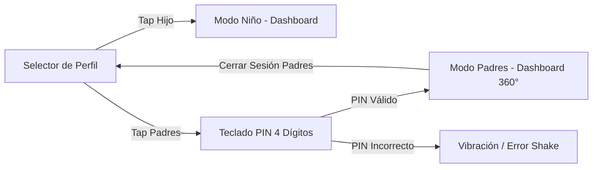

# ADR 0001: Arquitectura de Doble Modo (Padres vs Niños) con Barrera PIN

> **Estado:** Aceptado  
> **Fecha:** 2026-08-28  
> **Decisores:** Equipo de Arquitectura KidsTaskApp  

---

## 1. Contexto y Problema

En un entorno familiar de dispositivo compartido o multidispositivo, los niños interactúan directamente con la aplicación para ver y marcar sus tareas. Es crítico evitar que los niños modifiquen configuraciones, se acrediten puntos de forma unilateral, creen premios o eliminen sanciones. Al mismo tiempo, la experiencia para los niños debe ser fluida, sin necesidad de contraseñas complejas o logins engorrosos de correo electrónico.

---

## 2. Decisión

Se adopta una **Arquitectura de Doble Modo** con un punto de entrada común (`ProfileSelector`):
1. **Modo Niños (`activeRole: 'child'`):** Entrada directa en 1-tap al seleccionar el avatar del hijo. Interfaz de solo interacción infantil (solicitar visto bueno en tareas, **solicitar canje de premios**, ver logros). Sin botones de gestión administrativa ni deducción unilateral de puntos.
2. **Modo Padres (`activeRole: 'parent'`):** Acceso protegido por una compuerta modal de PIN (`PinGateModal`) con teclado virtual táctil de 4 dígitos.
3. El PIN maestro se almacena en el estado familiar (`family.masterPin`) y se valida antes de conmutar el rol activo a `parent`.
4. El retorno de Modo Padres a Selector de Perfil o Modo Niño bloquea nuevamente la sesión parental.

---

## 3. Consecuencias

### Positivas:
- **Cero Fricción para el Niño:** Acceso instantáneo a su dashboard gamificado.
- **Seguridad Robusta en el Hogar:** Imposibilidad de manipulación de puntos o aprobaciones por parte de menores.
- **Soporte Multi-Hijo Fluido:** Fácil cambio de contexto entre hermanos.

### Riesgos y Mitigaciones:
- *Riesgo:* Olvido del PIN maestro por parte del padre.
- *Mitigación:* Se implementa un mecanismo de **Recuperación y Respaldo por Biometría del Dispositivo (Huella Digital / Face ID / WebAuthn)** en smartphones. Si el tutor olvida su PIN, pulsa *"¿Olvidaste tu PIN?"*, valida su huella digital ante el sistema operativo del teléfono, y el sistema le permite restablecer inmediatamente un nuevo PIN de 4 dígitos sin requerir servidores externos de correo.
