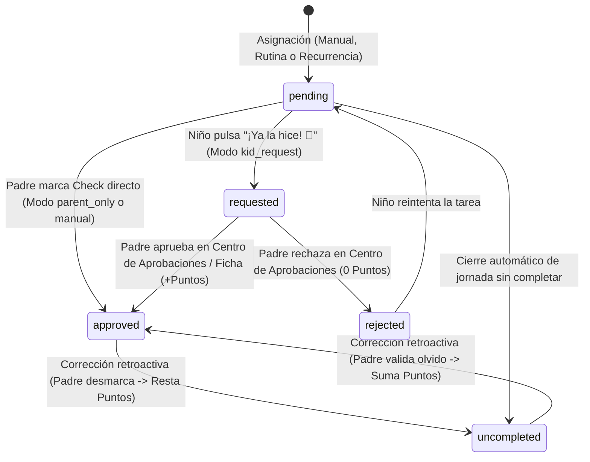
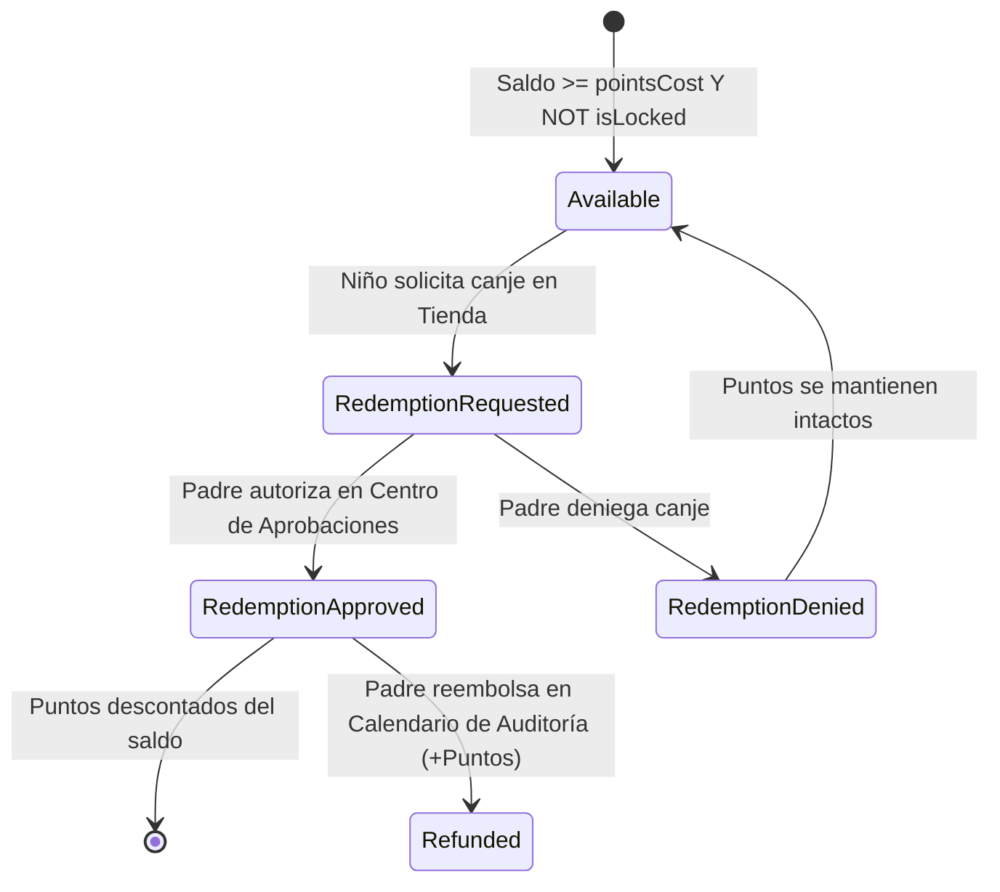

# Contrato de Estados y Protocolo de Eventos

> **Versión:** 1.0.0  
> **Área:** Contratos de Interfaz y Transiciones de Estado  

---

## 1. Ciclo de Vida de una Asignación Diaria (`DailyAssignment`)

Una tarea diaria asignada a un hijo transita por los siguientes estados discretos:



### Reglas de Transición:
1. `pending -> requested`: Solo invocable por el rol `child`.
2. `requested -> approved`: Requiere rol `parent`. Dispara evento `TRANSACTION_CREATED` con `type: 'task_reward'`.
3. `requested -> rejected`: Requiere rol `parent`. No altera el balance de puntos.
4. `approved -> uncompleted`: Requiere rol `parent`. Dispara evento compensatorio que deduce los puntos originales.

---

## 2. Ciclo de Canje de Premios (`Reward Redemption`)



---

## 3. Protocolo de Reordenamiento Secuencial (`Drag & Drop / Arrows`)

1. **Payload del Evento `REORDER_DAILY_TASKS`:**
   ```json
   {
     "childId": "child-mateo",
     "date": "2026-08-28",
     "orderedTaskIds": ["task-102", "task-101", "task-103", "task-104"]
   }
   ```
2. **Postcondición:** Cada tarea listada actualiza su atributo `orderIndex = index_in_array` de forma continua (`0, 1, 2, ...`).

---

## 4. Protocolo de Detección de Duplicados

Cuando se ejecuta `INJECT_ROUTINE` o `ASSIGN_TASK`:
1. El sistema evalúa: `existingTasks = dailyAssignments.filter(t => t.childId === childId && t.date === targetDate && t.title.toLowerCase() === candidate.title.toLowerCase())`.
2. Si `existingTasks.length > 0`:
   - El sistema suspende la inserción y despacha el evento de UI `TRIGGER_DUPLICATE_MODAL`.
   - Si el usuario selecciona `'omit'`: La tarea en conflicto se descarta del lote a insertar.
   - Si el usuario selecciona `'allow_x2'`: La tarea se inserta con `instanceTag: 'instance_' + (existingTasks.length + 1)`.
