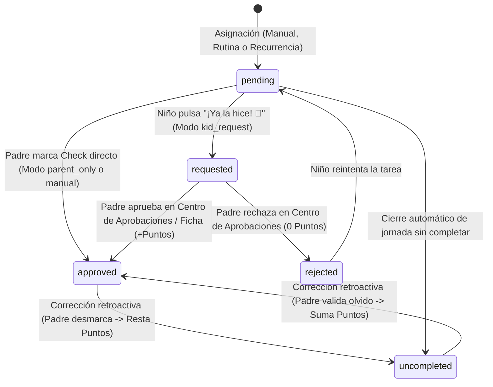
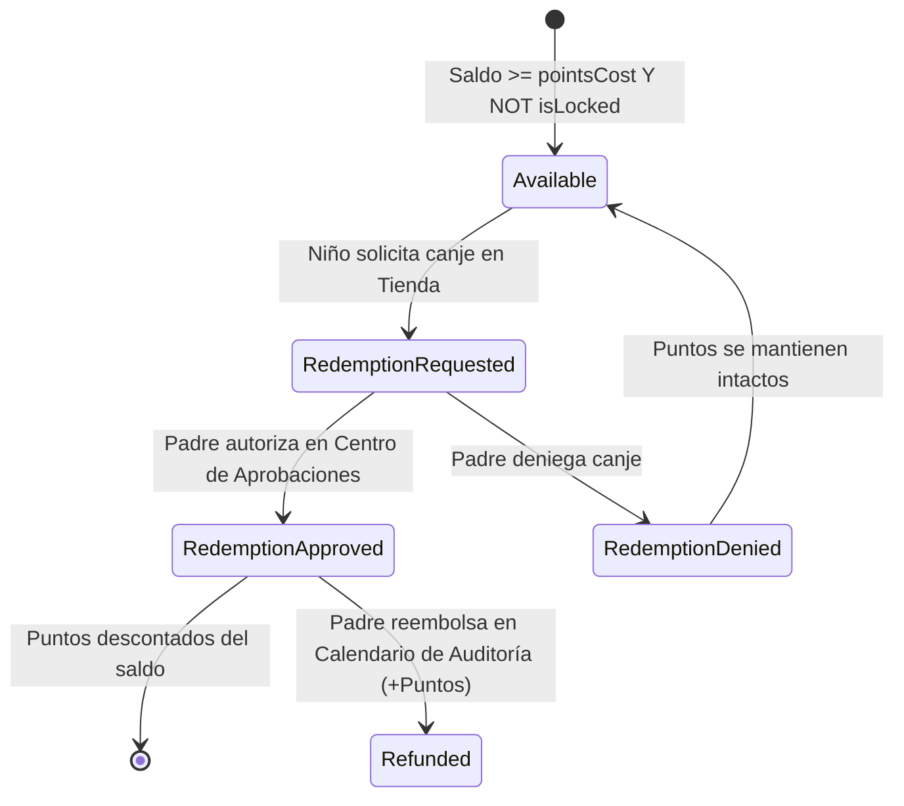

# Contrato de Estados y Protocolo de Eventos

> **Versión:** 1.0.0  
> **Área:** Contratos de Interfaz y Transiciones de Estado  

---

## 1. Ciclo de Vida de una Asignación Diaria (`DailyAssignment`)

Una tarea diaria asignada a un hijo transita por los siguientes estados discretos:



### Reglas de Transición:
1. `pending -> requested`: Solo invocable por el rol `child`.
2. `requested -> approved`: Requiere rol `parent`. Dispara evento `TRANSACTION_CREATED` con `type: 'task_reward'`.
3. `requested -> rejected`: Requiere rol `parent`. No altera el balance de puntos.
4. `approved -> uncompleted`: Requiere rol `parent`. Dispara evento compensatorio que deduce los puntos originales.

---

## 2. Ciclo de Canje de Premios (`Reward Redemption`)



---

## 3. Protocolo de Reordenamiento Secuencial (`Drag & Drop / Arrows`)

1. **Payload del Evento `REORDER_DAILY_TASKS`:**
   ```json
   {
     "childId": "child-mateo",
     "date": "2026-08-28",
     "orderedTaskIds": ["task-102", "task-101", "task-103", "task-104"]
   }
   ```
2. **Postcondición:** Cada tarea listada actualiza su atributo `orderIndex = index_in_array` de forma continua (`0, 1, 2, ...`).

---

## 4. Protocolo de Detección de Duplicados

Cuando se ejecuta `INJECT_ROUTINE` o `ASSIGN_TASK` (tanto para inyección masiva de rutinas como para asignación de una tarea maestra individual):
1. El sistema evalúa: `existingTasks = dailyAssignments.filter(t => t.childId === childId && t.date === targetDate && t.title.toLowerCase().trim() === candidate.title.toLowerCase().trim())`.
2. Si `existingTasks.length > 0`:
   - El sistema suspende la inserción y despacha el evento de UI `TRIGGER_DUPLICATE_MODAL`.
   - Si el usuario selecciona `'omit'`: La tarea en conflicto se descarta del lote a insertar (se conserva únicamente la regla de programación sin duplicar la instancia en la jornada de hoy).
   - Si el usuario selecciona `'allow_x2'`: La tarea se inserta con `instanceTag: 'instance_' + (existingTasks.length + 1)` y se preserva `masterTaskId`.

---

## 5. Protocolo de Evaluación Temporal de Asignaciones (`shouldScheduleApplyOnDate`)

Al asignar una tarea maestra o al generarse el inicio de una nueva jornada (`executeDailyReset`), el sistema determina si una regla de programación aplica para una fecha determinada `targetDateStr` mediante la función pura `shouldScheduleApplyOnDate(assignment, targetDateStr)`:
1. **Verificación de Exclusiones y Pausas:**
   - Si `assignment.skippedDate === targetDateStr`: Retorna `false` (omisión exclusiva para esa fecha).
   - Si `assignment.isPaused` y `assignment.pausedUntil && assignment.pausedUntil > targetDateStr`: Retorna `false` (suspensión activa).
2. **Evaluación por Modalidad (`scheduleType`):**
   - `'today'`: Retorna `true` solo si `targetDateStr` coincide con la fecha de asignación.
   - `'daily'`: Retorna `true` todos los días.
   - `'weekdays'`: Retorna `true` si el día de la semana de `targetDateStr` está entre lunes y viernes (1 a 5).
   - `'weekly'`: Retorna `true` si el nombre o índice del día de la semana de `targetDateStr` está contenido en `scheduleDetails` (ej. `["Lunes", "Jueves"]`).
   - `'specific_date'`: Retorna `true` únicamente si `targetDateStr === scheduleDetails`.
   - `'date_range'`: Retorna `true` si `targetDateStr >= startDate && targetDateStr <= endDate`.

---

## 6. Protocolo de Cierre de Jornada y Archivado Histórico (`DAILY_RESET`)

A las 23:59:59 o al ejecutarse la transición de día:
1. **Consolidación en `calendarHistory`:**
   - Las instancias de `todayAssignments` de cada hijo se archivan en `calendarHistory[dateStr][childId]`.
   - Las tareas en estado `'pending'` o `'requested'` transitan a estado `'missed'`.
   - Los bonos, sanciones y canjes de la jornada se asocian a la entrada histórica de la fecha.
   - Se calcula el `netPoints` y el `status` del mapa de calor (`full`, `partial`, `missed`, `empty`).
2. **Liquidación y Reinicio de Saldo:**
   - Si `pointsRule === 'daily_reset'`, o si `pointsRule === 'weekly_reset'` y `dayOfWeek === Domingo (0)`:
     - Si `autoLiquidation.enabled === true` y `child.currentPoints > 0`: Emite transacción `reward_redemption` liquidando el saldo a 0 y registrando la compensación monetaria o en premio.
     - Si `autoLiquidation.enabled === false`: El saldo `currentPoints` se reinicia a 0.
   - Si `pointsRule === 'continuous'`: El saldo `currentPoints` permanece intacto para el día siguiente.

---

## 7. Protocolo de Reversión y Auditoría Retroactiva

1. **Reversión de Tarea Aprobada Pasada (`AUDIT_REVOKE_TASK`):**
   - Transición: `approved -> uncompleted` con `isRetroactivelyModified: true`.
   - Emisión de transacción `retroactive_adjustment` por `-task.points`.
   - Regla de compensación en saldo: Si el hogar opera bajo `daily_reset` o `weekly_reset` y la fecha auditada es anterior a la jornada activa, solo se deducirán del saldo de hoy los puntos que fueron efectivamente consumidos en canjes o auto-liquidaciones durante esa fecha cerrada.
2. **Reembolso de Canje Pasado (`REFUND_REDEMPTION`):**
   - Transición idempotente: Solo ejecutable si `redemption.isRefunded === false`.
   - Marca la transacción de canje original como `isReversed: true` y `reversedBy: tutor.name`.
   - Emisión de transacción compensatoria `refund_reversal` por `+pointsCost`.
   - Restitución inmediata al saldo del niño (`currentPoints += pointsCost`).
3. **Anulación de Sanción / Bono Pasado (`REVERT_BONUS_OR_PENALTY`):**
   - Marca el registro en `penaltiesList` o `bonuses` como `isReversed: true`.
   - Emite una transacción compensatoria de tipo `retroactive_adjustment` con signo invertido.
   - Recalcula el `netPoints` del día y el saldo disponible del niño.
